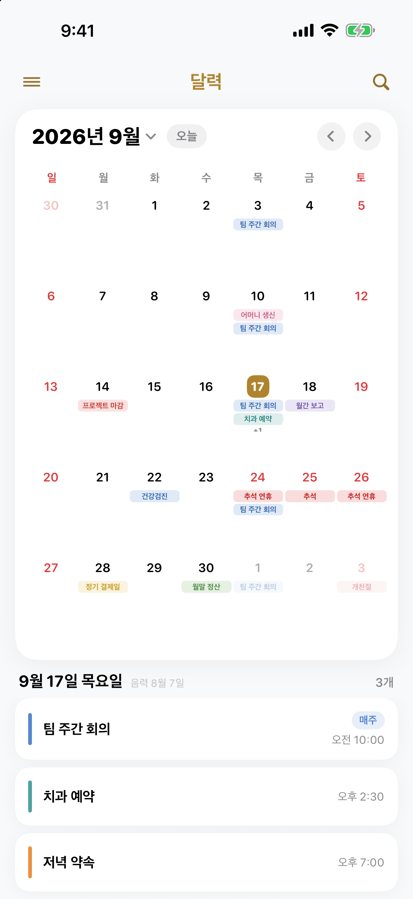
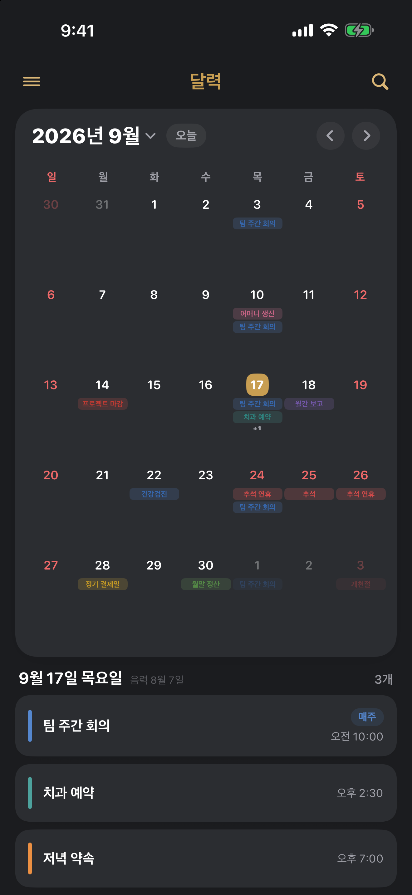
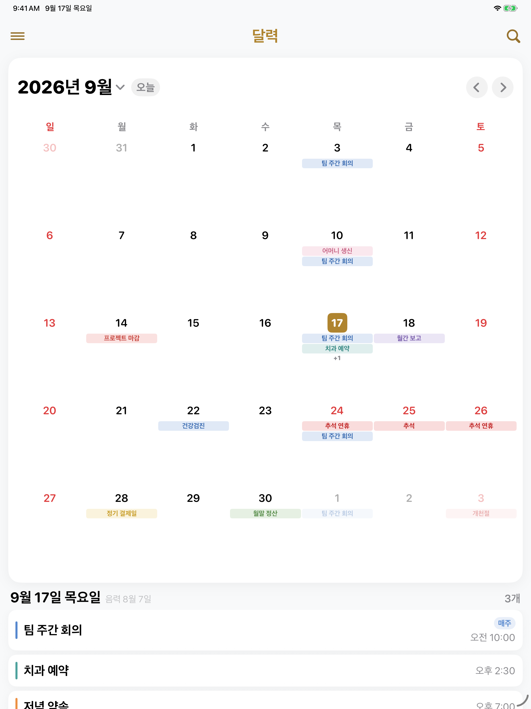

<div align="center">

# 📅 하상원의 달력

**음력과 한국 공휴일을 지원하는 무료 캘린더 · 위젯 앱 — iOS · Android**


</div>

---

## 📸 스크린샷

<div align="center">

<table>
  <tr>
    <td align="center"><b>달력 · 일정</b></td>
    <td align="center"><b>다크 모드</b></td>
  </tr>
  <tr>
    <td></td>
    <td></td>
  </tr>
</table>

<br>

<b>iPad</b><br>


</div>

---

## ✨ 주요 기능

- **달력 / 일정** — 월 달력, 일정 추가·수정, 반복(단일/매주/매달)·종료일·색상
- **한국 공휴일** — 2025~2027 확정 + 이후 연도 자동 계산 (음력 환산 · 대체공휴일)
- **음력** — 선택 날짜의 음력 표시, 매년 기념일(양력/음력) 등록
- **홈 위젯** — Small / Medium / Large 3종, 앱과 별도로 글자 크기 설정
- **알림** — 알림 켠 일정이 있는 날 하루 1회 일괄 알림 (시간 지정)
- **동기화** — iOS: iCloud · 애플 달력 읽기 / Android: 안드로이드 달력 읽기 (각각 on/off)
- **백업** — `.hscal` 내보내기·가져오기 (두 플랫폼 간 호환), `.redcalendar` 가져오기
- **검색 / 연월 이동 / 테마 · 배경색 / 글자 크기 / 다크모드**

---

## 📂 구조 (모노레포)

```
ios/        SwiftUI · SwiftData · WidgetKit 앱  (project.yml = XcodeGen 원본)
android/    Kotlin · Jetpack Compose · Glance 앱 (Gradle)
common/     두 플랫폼 공용 — 공휴일 데이터, 테스트 기대값, 백업 형식 명세, 색 토큰, 스토어 자산, 문서
docs/       개인정보 처리방침
```

플랫폼별 빌드 방법과 규칙은 `ios/CLAUDE.md`, `android/CLAUDE.md` 참조.

---

## 🚀 빌드

### iOS

```bash
brew install xcodegen        # 최초 1회
cd ios
xcodegen generate            # PlanWidget.xcodeproj 생성
open PlanWidget.xcodeproj
```

### Android

```bash
cd android
./gradlew :app:assembleDebug # 또는 Android Studio 로 android/ 열기
```

---

## 📦 배포

| 구분                                   | iOS                                                      | Android                 |
| -------------------------------------- | -------------------------------------------------------- | ----------------------- |
| 스토어 이름                            | 하상원의 달력                                            | 하상원의 달력           |
| 부제 / 간단한 설명                     | 광고없는 캘린더 음력 생일 일정 관리 기념일 위젯          | (Play 등록 시 확정, 80자 이내) |
| 기기 표시 이름                         | 하상원 달력 (`CFBundleDisplayName`)                        | 하상원 달력 (`app_name`) |
| 식별자                                 | `com.hasangwon.planwidget`                               | `com.hasangwon.planwidget` |

> ⚠️ iOS: 두 이름이 충분히 비슷하지 않으면 App Store 심사에서 거절된다 (Guideline 2.3.8 - Accurate Metadata).
> 기기 표시 이름은 `ios/project.yml`의 앱·위젯 양쪽 `CFBundleDisplayName`에 있고,
> 수정 후 `xcodegen generate`를 돌려야 `Info.plist`에 반영된다.
> 재제출 시 `CURRENT_PROJECT_VERSION`을 올린 뒤, App Store Connect의 버전 페이지에서 새 빌드를 명시적으로 선택해야 한다.

Play 스토어 등록 절차는 `common/docs/play-console.md` 참조.
